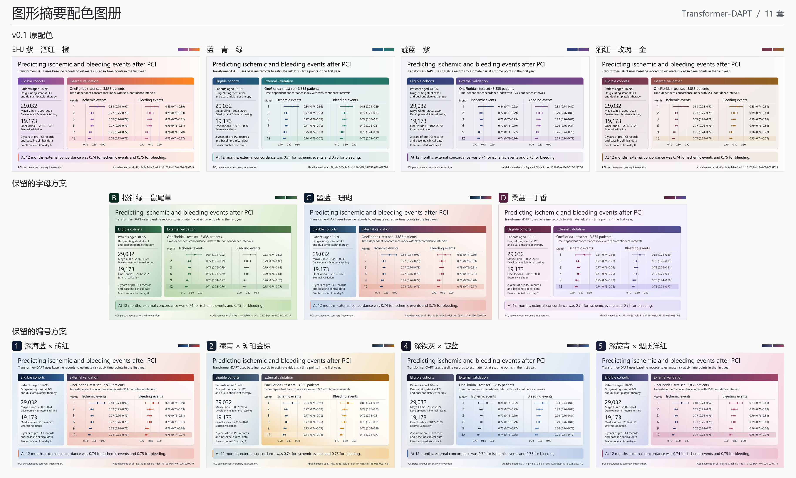
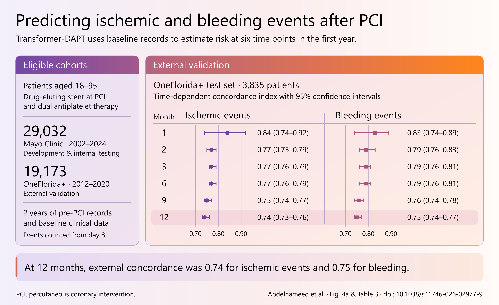

# Graphical Abstract for Codex

用于从研究论文、表格和图稿制作科学图形摘要。项目由 AI 根据用户需求制作，使用 MIT 许可证。

| 版本 | 安装目录 | 调用名称 | 默认交付 |
| --- | --- | --- | --- |
| v0.2（当前） | [graphical-abstract-v0-2](graphical-abstract-v0-2/) | `$graphical-abstract-v0-2` | 可编辑 SVG，EHJ 配色 |
| v0.1 | [graphical-abstract-v0-1](graphical-abstract-v0-1/) | `$graphical-abstract-v0-1` | 高清 PNG，EHJ 配色 |

两个版本可并排安装。旧版的安装方法、配色与示例见 [v0.1 原版说明](README.v0.1.md)。

## Graphical Abstract v0.2

用论文、研究表格和图稿制作一张可核对的图形摘要。每次使用先选择输出格式和配色。回复“默认”即可获得 **可编辑 SVG + EHJ 紫—酒红—橙渐变**。

[查看 11 套配色总览](graphical-abstract-v0-2/examples/transformer-dapt/palette-atlas/overview.png)。下载仓库后，在浏览器中打开 [离线图册](graphical-abstract-v0-2/examples/transformer-dapt/palette-atlas/index.html)，即可放大或切换各套成图。图册包含 v0.1 的四套原配色、字母方案 B/C/D 和编号方案 1/2/4/5。蓝—青—绿与靛蓝—紫均使用 v0.1 原始色标。[双图对照](graphical-abstract-v0-2/examples/transformer-dapt/palette-atlas/blue-teal-and-indigo.png)

## v0.2 相比 v0.1 的更新

| 项目 | v0.1 | v0.2 |
| --- | --- | --- |
| 启动方式 | 按默认设置生成 PNG 预览，可指定其他格式和配色 | 每次先询问目标格式和配色，一次可选多种格式 |
| 默认交付 | PNG，EHJ 配色 | **可编辑 SVG，EHJ 配色** |
| 文件导出 | 附 SVG 换色和 PNG 渲染工具，PPTX 按需制作 | 增加可编辑 PowerPoint（.pptx）导出，可从同一底稿交付 SVG、PPTX 和 PNG |
| 配色 | 四套渐变色板 | 保留原四套，新增 B/C/D 和 1/2/4/5，共 11 套，每套配同一研究的完整示意图 |
| 示例 | 无研究内容的色板和制作说明 | Transformer-DAPT 任务单、逐项证据、三格式成图及可复现的本地示例 |

## 开始制图

第一步会询问两件事：**输出可编辑 SVG、可编辑 PowerPoint、PNG，还是多种？配色选 EHJ、图册里的某套，还是自定义？** 已填写的选项会带入询问。回复“默认”选择 SVG + EHJ；回复“PPTX 和 PNG，用 C”会交付同一张墨蓝—珊瑚摘要图的两个文件。



## 从一篇论文到一张图

示例选用 Abdelhameed 等发表在 *npj Digital Medicine* 的 Transformer-DAPT 研究。作者使用 PCI 前的电子病历，预测术后接受双联抗血小板治疗患者的缺血与出血事件。我们选择把两种结局在外部测试集的表现放在同一张图上。[论文全文与表 3](https://pmc.ncbi.nlm.nih.gov/articles/PMC13653921/#Tab3)



| 从哪里开始 | 可以看到什么 |
| --- | --- |
| [制图任务单](graphical-abstract-v0-2/examples/transformer-dapt/brief.md) | 原文链接、读者、主问题和成图要求，可直接复用这种提问方式 |
| [示例讲解](graphical-abstract-v0-2/examples/transformer-dapt/README.md) | 哪些结果入图、哪些留在原文，以及如何核对其中一个数据点 |
| [证据记录](graphical-abstract-v0-2/examples/transformer-dapt/evidence.json) | 队列、结局、预测时点、点估计、置信区间和对应原文位置 |
| [可编辑 PowerPoint](graphical-abstract-v0-2/examples/transformer-dapt/figure.pptx) · [可编辑 SVG](graphical-abstract-v0-2/examples/transformer-dapt/figure.svg) · [高清 PNG](graphical-abstract-v0-2/examples/transformer-dapt/figure.png) | 同一张 EHJ 示例的三种文件。PowerPoint 可分别编辑文字、点估计和置信区间；PNG 为 3600 × 2200 像素。 |

## 怎么选配色

可使用中文名、字母、编号或配色 ID 指定方案。例如，“用 v0.1 蓝—青—绿”会采用原有的蓝绿渐变，“用 C”会采用墨蓝经莓紫过渡到珊瑚红的渐变。[配色名称、高清图及可编辑文件](graphical-abstract-v0-2/references/palette-guide.md)

## 用于自己的论文

将 `graphical-abstract-v0-2` 文件夹复制到本机 Codex 技能目录。在 Windows 下通常为 `%USERPROFILE%\.codex\skills\`，在 macOS 或 Linux 下通常为 `~/.codex/skills/`。已设置 `CODEX_HOME` 时使用其下的 `skills/`。可以用以下请求开始：

```text
使用 $graphical-abstract-v0-2，按我提供的原稿和表 2 制作一张英文 graphical abstract。
读者是心血管研究者。重点呈现外部验证结果，请使用 C（墨蓝—珊瑚）配色。
```

默认交付一张可编辑 SVG。选择 PowerPoint 时使用现代 `.pptx` 格式，选择 PNG 时输出高清位图。所需环境、导出命令和换色方法见[工具说明](graphical-abstract-v0-2/references/tools-and-output.md)，内容提取和核对方法见[制作指南](graphical-abstract-v0-2/SKILL.md)。

## 来源与许可

项目代码与工作流说明沿用 [MIT 许可证](LICENSE)。示例根据公开论文报告的汇总数值独立制图，引用位置保存在证据记录中。论文及原文图表适用作者标注的 [CC BY-NC-ND 4.0](https://creativecommons.org/licenses/by-nc-nd/4.0/)。此包只带原创布局、文字和数据标记。
