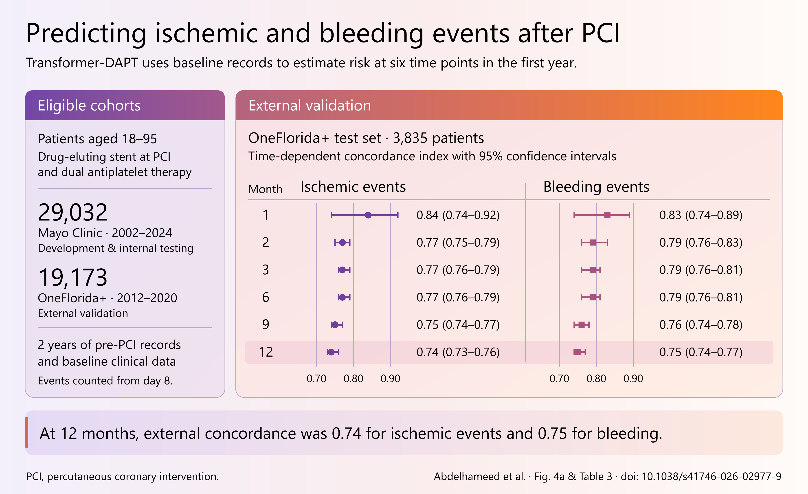

# Transformer-DAPT：从论文到图形摘要

研究者希望知道，依据术前已有的病历信息，模型能否区分 PCI 后发生缺血或出血风险不同的患者。这个示例把 OneFlorida+ 外部测试集放在图的中心。论文的作者为 Ahmed Abdelhameed、Zenan Sun、Yue Yu 等，发表于 *npj Digital Medicine*（2026 年，第 9 卷，781）。[研究全文](https://pmc.ncbi.nlm.nih.gov/articles/PMC13653921/)



[完整配色图册](palette-atlas/index.html)把 v0.1 的四套原配色、B/C/D 和 1/2/4/5 放在一起，展示同一组研究数据与同一排版。蓝—青—绿和靛蓝—紫另有[原方案双图对照](palette-atlas/blue-teal-and-indigo.png)。[高清图与 SVG 索引](../../references/palette-guide.md)

## 从哪几处取材

| 原文位置 | 从中读取什么 | 放在图中的位置 |
| --- | --- | --- |
| 方法 · Data source and study cohort、图 4a | Mayo Clinic 符合条件者 29,032 人，其中 5,807 人进入内部测试集。OneFlorida+ 符合条件者 19,173 人，其中随机选取 3,835 人进入外部测试集。 | 队列规模与实际测试人数分开标注。外部区分度对应 3,835 人。[图 4a](https://pmc.ncbi.nlm.nih.gov/articles/PMC13653921/#Fig4) |
| 方法 · Data preparation、Study outcomes | 输入包括基线特征与 PCI 前两年的病历。研究从 PCI 后第 8 天开始计入结局。 | 用一行交代输入和随访时间。六个预测时点共用这组基线信息。 |
| 表 3 · Transformer-DAPT 两行 | 取两个结局在 1、2、3、6、9、12 个月的时间依赖性 C 指数及 95% CI。 | 用共用刻度呈现 12 个点和各自区间。时点是 PCI 后的月数。 |
| 表 2 · Transformer-DAPT 两行 | Mayo 测试集对应的 12 个结果。 | 存入证据文件，供核查开发队列与外部队列的区别。 |

校准分析、DeepHit 与 DeepSurv 的比较回答的是另外的问题，保留在原文中。例图选取的 C 指数衡量区分度，有关治疗时长的选择需要另外的研究证据。研究者还报告，OneFlorida+ 初筛人群中约 71% 被排除，主要与记录完整性有关，读者可据此判断外部队列的代表性。[方法与讨论](https://pmc.ncbi.nlm.nih.gov/articles/PMC13653921/) · [表 2](https://pmc.ncbi.nlm.nih.gov/articles/PMC13653921/#Tab2) · [表 3](https://pmc.ncbi.nlm.nih.gov/articles/PMC13653921/#Tab3)

## 核对一个数据点

打开表 3，找到 **Task: Ischemic → Transformer-DAPT → 12-M**。点估计是 **0.74**，95% CI 为 **0.73–0.76**。在成图里找到缺血结局的 12 个月一行，核对点的位置和区间两端。在同一表格的出血部分，12 个月为 **0.75**（95% CI **0.74–0.77**）。如果把两行互换，数字依然形似合理，因此回查时必须同时读结局名、时点和列头。[原文表 3](https://pmc.ncbi.nlm.nih.gov/articles/PMC13653921/#Tab3)

## 查看或复用

- 把[任务单](brief.md)作为一篇新论文的请求格式。
- 从[证据记录](evidence.json)回查两个队列、结局定义、时点和原文位置。
- 主图提供[可编辑 PowerPoint](figure.pptx)、[可编辑 SVG](figure.svg)和[高清 PNG](figure.png)。PPTX 中的标签、数据点与置信区间都可以单独编辑。
- [示例脚本](build_figure.py)默认从同一份证据记录生成 EHJ 配色的 SVG。SVG 使用 Python 标准库即可，PNG 另需 Node.js 和 Sharp，PPTX 按[PowerPoint 导出说明](../../references/pptx-export.md)安装依赖。

在本示例目录运行以下命令，结果写入 `rebuild/`。第一条采用默认设置，只生成 EHJ 的 SVG。第二条生成与交互流程中“用 C，三种格式都要”对应的结果。需要指定本机 Sharp 时可追加 `--sharp-module` 和模块目录。

```sh
python build_figure.py --output-dir rebuild
python build_figure.py --palette C --format svg pptx png --output-dir rebuild/color-C
```

在同一目录运行以下命令，可以分别重建三组高清配色图，再更新拼图。总览脚本使用 Pillow。Windows 默认使用微软雅黑；在其他系统可通过 `--font` 提供本机的中文字体文件。

```sh
python build_figure.py --v01-palettes --format svg png
python build_figure.py --color-options --format svg png
python build_figure.py --reference-palettes --format svg png
python palette-atlas/build_overview.py
```

