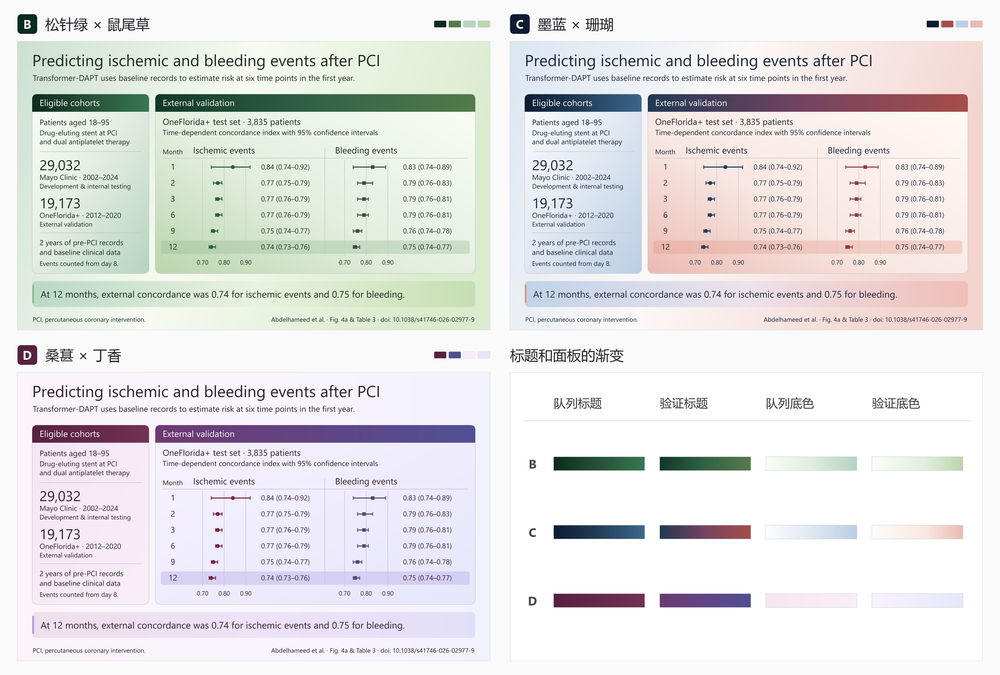

# Transformer-DAPT · 已保留的 B、C、D

三套成图保留原编号。可打开高清图查看数据标记和置信区间，或用对应的 SVG 继续编辑。

与 v0.1 及 1/2/4/5 并排比较可打开[完整图册](../palette-atlas/index.html)。



| 方案 | 画面特点 | 高清图 | 可编辑文件 |
| --- | --- | --- | --- |
| **B　松针绿—鼠尾草** | 标题从深松绿经过森林绿过渡到鼠尾草绿，浅色面板沿对角加深，突出右侧验证结果。 | [PNG](B-pine-sage.png) | [SVG](B-pine-sage.svg) |
| **C　墨蓝—珊瑚** | 验证标题从墨蓝经莓紫转为珊瑚红，结论条用较浅的蓝粉渐变呼应两个分区。 | [PNG](C-ink-coral.png) | [SVG](C-ink-coral.svg) |
| **D　桑葚—丁香** | 深莓紫标题落在淡丁香底上，两个结果区保持清晰的层次。 | [PNG](D-mulberry-lilac.png) | [SVG](D-mulberry-lilac.svg) |

每张 PNG 均为 3600 × 2200 像素。三套方案的色值、渐变和数据标记配置见[统一配色参数](../../../references/palettes.json)。在[示例目录](../README.md)运行以下命令，可重建这三套 SVG 和 PNG。

```sh
python build_figure.py --color-options --format svg png
```
