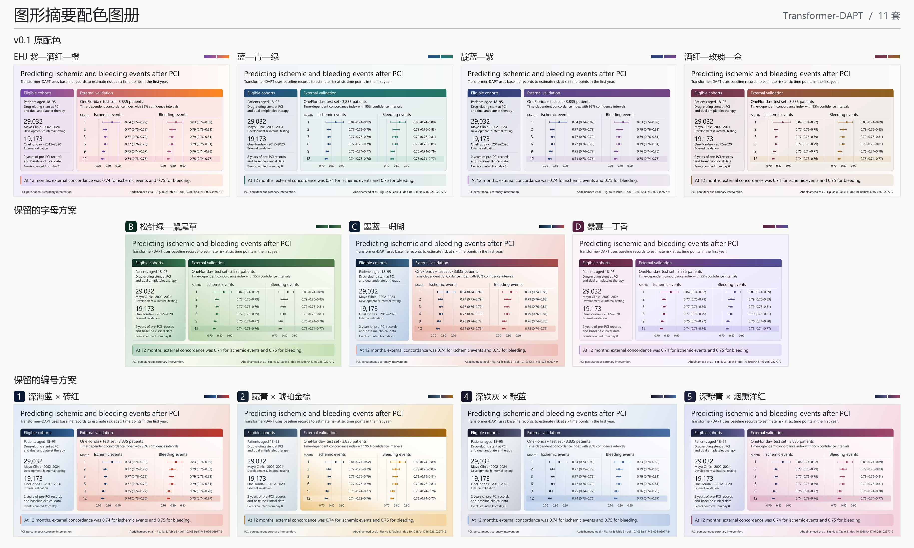

# 11 套配色图册

[打开交互图册](../examples/transformer-dapt/palette-atlas/index.html)可在同一版式中放大比较。每张 PNG 均为 3600 × 2200 像素，每套 SVG 都保留可编辑的文字、数据点及置信区间。

## v0.1 原配色

蓝—青—绿与靛蓝—紫沿用 v0.1 的原始渐变方向、色标和位置。[两套原方案并排对照](../examples/transformer-dapt/palette-atlas/blue-teal-and-indigo.png)

| 配色 | 配色 ID | 成图 |
| --- | --- | --- |
| EHJ 紫—酒红—橙 | `ehj-default` | [高清 PNG](../examples/transformer-dapt/v01-palettes/ehj-default.png) · [可编辑 SVG](../examples/transformer-dapt/v01-palettes/ehj-default.svg) |
| 蓝—青—绿 | `blue-teal-jade` | [高清 PNG](../examples/transformer-dapt/v01-palettes/blue-teal-jade.png) · [可编辑 SVG](../examples/transformer-dapt/v01-palettes/blue-teal-jade.svg) |
| 靛蓝—紫 | `indigo-violet` | [高清 PNG](../examples/transformer-dapt/v01-palettes/indigo-violet.png) · [可编辑 SVG](../examples/transformer-dapt/v01-palettes/indigo-violet.svg) |
| 酒红—玫瑰—金 | `burgundy-rose-gold` | [高清 PNG](../examples/transformer-dapt/v01-palettes/burgundy-rose-gold.png) · [可编辑 SVG](../examples/transformer-dapt/v01-palettes/burgundy-rose-gold.svg) |

## 保留的字母方案

| 配色 | 配色 ID | 成图 |
| --- | --- | --- |
| B　松针绿—鼠尾草 | `pine-sage` | [高清 PNG](../examples/transformer-dapt/color-options/B-pine-sage.png) · [可编辑 SVG](../examples/transformer-dapt/color-options/B-pine-sage.svg) |
| C　墨蓝—珊瑚 | `ink-coral` | [高清 PNG](../examples/transformer-dapt/color-options/C-ink-coral.png) · [可编辑 SVG](../examples/transformer-dapt/color-options/C-ink-coral.svg) |
| D　桑葚—丁香 | `mulberry-lilac` | [高清 PNG](../examples/transformer-dapt/color-options/D-mulberry-lilac.png) · [可编辑 SVG](../examples/transformer-dapt/color-options/D-mulberry-lilac.svg) |

## 保留的编号方案

| 配色 | 配色 ID | 成图 |
| --- | --- | --- |
| 1　深海蓝 × 砖红 | `navy-brick` | [高清 PNG](../examples/transformer-dapt/reference-palettes/1-navy-brick.png) · [可编辑 SVG](../examples/transformer-dapt/reference-palettes/1-navy-brick.svg) |
| 2　藏青 × 琥珀金棕 | `navy-amber` | [高清 PNG](../examples/transformer-dapt/reference-palettes/2-navy-amber.png) · [可编辑 SVG](../examples/transformer-dapt/reference-palettes/2-navy-amber.svg) |
| 4　深铁灰 × 靛蓝 | `iron-steel` | [高清 PNG](../examples/transformer-dapt/reference-palettes/4-iron-steel.png) · [可编辑 SVG](../examples/transformer-dapt/reference-palettes/4-iron-steel.svg) |
| 5　深靛青 × 烟熏洋红 | `indigo-berry` | [高清 PNG](../examples/transformer-dapt/reference-palettes/5-indigo-berry.png) · [可编辑 SVG](../examples/transformer-dapt/reference-palettes/5-indigo-berry.svg) |

## 应用到新图

用中文名、字母、编号或配色 ID 选择方案。渐变方向和全部色标收在同一份[配色参数](palettes.json)里。新图可沿用标题和面板渐变，用实色、点形和直接标注区分结局。

四套 v0.1 配色都沿用原始渐变。EHJ 方案中，右侧标题越靠橙色端，白字对比度越低。此例保留原来的色标，并使用大号白字。缩小标题时，可将文字移向较深的一端或局部加深标题背景。
